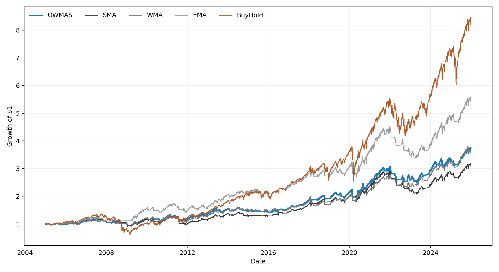
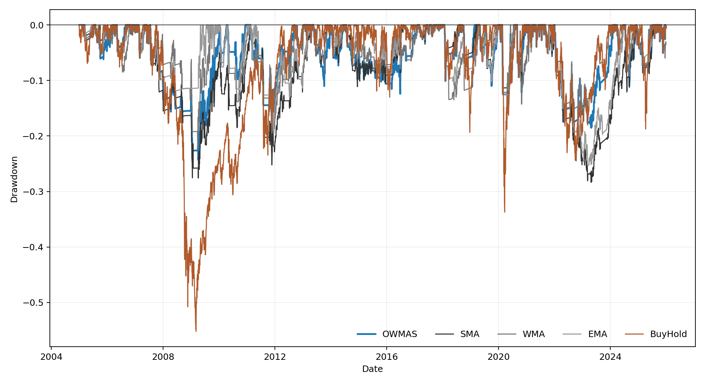
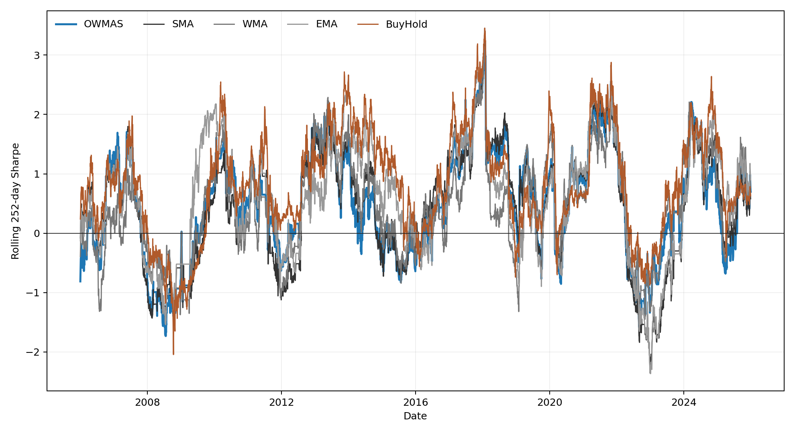

# Results and Discussion

Draft for the Week 11 learning-contract checkpoint. All values in this chapter
come from the first registered experiment run. The analysis used 5,282 trading
days from 3 January 2005 to 30 December 2025, 10,000 bootstrap replications,
the registered seed 14487692, and 95% confidence intervals.

## 4. Results

### 4.1 Full-sample performance

Table 1 reports the full-sample performance of the registered neutral OWMAS,
the three moving-average benchmarks, and buy-and-hold. OWMAS produced a
274.26% cumulative return, a 6.50% compound annual growth rate, and an
annualised Sharpe ratio of 0.458. Its maximum drawdown was -24.60%, annualised
volatility was 11.45%, and market exposure was 69.22%. The strategy recorded
109 position changes.

**Table 1. Full-sample performance, 3 January 2005 to 30 December 2025**

| Strategy | Cumulative return | CAGR | Sharpe | Sortino | Maximum drawdown | Volatility | Exposure | Trades |
| --- | ---: | ---: | ---: | ---: | ---: | ---: | ---: | ---: |
| OWMAS | 274.26% | 6.50% | 0.458 | 0.627 | -24.60% | 11.45% | 69.22% | 109 |
| SMA | 216.92% | 5.66% | 0.383 | 0.516 | -28.36% | 11.71% | 69.14% | 105 |
| WMA | 265.81% | 6.38% | 0.459 | 0.627 | -22.07% | 11.12% | 68.33% | 133 |
| EMA | 456.22% | 8.53% | 0.627 | 0.863 | -25.35% | 11.37% | 74.52% | 73 |
| Buy-and-hold | 741.02% | 10.69% | 0.539 | 0.758 | -55.19% | 19.05% | 100.00% | 1 |

The point estimates do not show uniform OWMAS dominance. OWMAS had a higher
Sharpe ratio than SMA, was effectively level with WMA, and had a lower Sharpe
ratio than EMA and buy-and-hold. Buy-and-hold generated the largest return but
also had much greater volatility and a substantially deeper maximum drawdown.
The equity and drawdown paths are shown in Figures 1 and 2.

### 4.2 H1: Sharpe-ratio effectiveness

The paired Ledoit-Wolf tests did not find a statistically significant Sharpe
improvement for OWMAS. The OWMAS minus SMA difference was 0.0754, with a 95%
confidence interval from -0.0685 to 0.2192 and p = 0.2980. The difference from
WMA was -0.0004, with p = 0.9976, and the difference from EMA was -0.1686,
with p = 0.1389. The additional comparison with buy-and-hold was also not
significant, with a difference of -0.0806 and p = 0.7067.

**Table 2. Paired Sharpe-ratio tests**

| Comparison | Difference | 95% confidence interval | Two-sided p-value |
| --- | ---: | ---: | ---: |
| OWMAS - SMA | 0.0754 | [-0.0685, 0.2192] | 0.2980 |
| OWMAS - WMA | -0.0004 | [-0.1860, 0.1853] | 0.9976 |
| OWMAS - EMA | -0.1686 | [-0.3937, 0.0565] | 0.1389 |
| OWMAS - buy-and-hold | -0.0806 | [-0.5537, 0.3925] | 0.7067 |

Every confidence interval includes zero. H1 is therefore not supported on the
full sample. The higher OWMAS Sharpe point estimate relative to SMA is not
enough to claim superior risk-adjusted performance.

### 4.3 H2: risk reduction

The risk comparisons were mixed. OWMAS annualised volatility was 0.26
percentage points lower than SMA, with a 95% confidence interval from -0.52 to
-0.00 percentage points and p = 0.0466. It was 0.33 percentage points higher
than WMA, with a confidence interval from 0.04 to 0.60 percentage points and
p = 0.0212. The volatility difference from EMA was not significant
(p = 0.7722). None of the maximum-drawdown differences between OWMAS and the
three moving-average benchmarks was statistically significant.

Relative to buy-and-hold, OWMAS reduced annualised volatility by 7.61
percentage points (p = 0.0001) and improved maximum drawdown by 30.59
percentage points (p = 0.0244). These results show the expected risk-control
effect of moving to cash, but do not establish that OWMAS provides a general
risk advantage over the conventional moving-average rules. H2 is therefore
mixed and is not supported as a broad claim of lower risk against all three
moving-average benchmarks. The nominal moving-average p-values should also be
read cautiously because several related comparisons were tested.

### 4.4 H3: rolling-Sharpe consistency

OWMAS had a median rolling 252-day Sharpe ratio of 0.515 and an interquartile
range of 1.346 across 5,031 windows. Its median was slightly below SMA, above
WMA, and below EMA and buy-and-hold. Its interquartile range was lower than
SMA and EMA, but higher than WMA and buy-and-hold.

**Table 3. Rolling 252-day Sharpe summary**

| Strategy | Median | Interquartile range | First quartile | Third quartile | Windows |
| --- | ---: | ---: | ---: | ---: | ---: |
| OWMAS | 0.515 | 1.346 | -0.187 | 1.159 | 5,031 |
| SMA | 0.532 | 1.399 | -0.276 | 1.123 | 5,031 |
| WMA | 0.428 | 1.198 | -0.138 | 1.061 | 5,031 |
| EMA | 0.684 | 1.404 | -0.124 | 1.280 | 5,031 |
| Buy-and-hold | 0.795 | 1.199 | 0.276 | 1.475 | 5,031 |

None of the paired tests found a significant OWMAS improvement in rolling
median or interquartile range. For example, the OWMAS minus SMA median
difference was -0.0172 (p = 0.8454), while the interquartile-range difference
was -0.0535 (p = 0.7154). Against WMA, the corresponding p-values were 0.5140
and 0.4064. H3 is not supported because no benchmark comparison showed both a
higher median rolling Sharpe and a reliably smaller spread.

### 4.5 H4: ordered-weighting profiles

The three pre-specified OWMAS profiles produced different descriptive results.
The optimistic profile had a Sharpe ratio of 0.419, the registered neutral
profile had 0.458, and the conservative profile had 0.519. Maximum drawdown
also improved across those point estimates, from -26.23% for the optimistic
profile to -24.60% for neutral and -21.80% for conservative. The neutral
configuration remains the primary model because it was selected before the
performance evaluation.

The paired profile tests found no significant Sharpe or maximum-drawdown
difference. They did find volatility differences for optimistic minus neutral
(p = 0.0038), optimistic minus conservative (p = 0.0007), and neutral minus
conservative (p = 0.0011). All three remain below the simple Bonferroni value
of 0.05 / 9 = 0.0056 for the nine H4 pairwise metric tests. H4 is therefore
supported only as evidence that the ordered-weighting profile changes strategy
volatility. It is not evidence that one profile improves risk-adjusted return.

### 4.6 Market-subperiod results

The pre-specified subperiod results were descriptive and varied by market
environment. During the global financial crisis, OWMAS returned -9.63% with a
-22.47% maximum drawdown. This was less severe than the -37.16% return and
-55.19% drawdown of buy-and-hold, although EMA was the only active strategy to
record a positive return, at 5.84%.

From 2010 to 2019, OWMAS returned 82.54% and had a Sharpe ratio of 0.574. It
outperformed SMA and WMA on those point estimates but trailed EMA, which had a
0.633 Sharpe ratio, and buy-and-hold, which had a 0.894 Sharpe ratio. During
2020, OWMAS returned 16.20% with a 0.933 Sharpe ratio. Its return was above WMA
but below SMA and EMA. Its maximum drawdown of -14.24% was substantially less
than the -33.72% drawdown of buy-and-hold.

During the 2022 tightening period, OWMAS returned -14.19%. This was the least
negative return among the five strategies, although its Sharpe ratio remained
negative at -1.179. The subperiods therefore show episodes of useful downside
control, but no consistent pattern of OWMAS dominance across regimes.

### 4.7 Holdout robustness

The pre-specified 2016 to 2025 holdout contained 2,513 trading days. OWMAS
returned 162.01%, had a 10.14% CAGR, a 0.714 Sharpe ratio, and a -18.52%
maximum drawdown. Its Sharpe point estimate was above SMA (0.654), WMA (0.681),
and EMA (0.697), but below buy-and-hold (0.738). Buy-and-hold returned 297.60%
and experienced a deeper -33.72% maximum drawdown.

The holdout is consistent with OWMAS remaining competitive with conventional
moving-average rules in the later sample. It does not overturn H1 because the
holdout comparison is descriptive, and the registered full-sample paired tests
remain the primary inferential result.

### 4.8 One-factor sensitivity

The sensitivity grid did not produce a uniform ranking. The conservative
profile had the strongest Sharpe point estimate at 0.519 and a -21.80% maximum
drawdown. Reducing beta to 0.25 produced a 0.492 Sharpe ratio and -22.76%
maximum drawdown, while increasing beta to 0.75 produced a 0.403 Sharpe ratio
and -29.84% drawdown. The alternative 10/30 windows produced a 0.488 Sharpe
ratio and the shallowest sensitivity-grid drawdown, at -17.98%, but increased
position changes to 175.

These checks show that the OWMAS outcome depends on its aggregation and window
settings. The conservative profile, beta 0.25, and 10/30 windows are not
promoted to primary specifications because they were registered as sensitivity
checks. Selecting the best result after observing the data would introduce
post-hoc model selection.

## 5. Discussion

### 5.1 Answer to the research question

The experiment does not provide evidence that the registered OWMAS improves
risk-adjusted performance over conventional moving-average signals. Its
full-sample Sharpe ratio was higher than SMA, almost identical to WMA, and lower
than EMA. The paired confidence intervals were wide enough to include zero in
every H1 comparison. The appropriate conclusion is a null result for superior
Sharpe performance, not a claim that the implementation or research design
failed.

OWMAS nevertheless behaved as a viable long-only trend signal. It reduced
exposure, volatility, and drawdown relative to passive buy-and-hold, and it
remained competitive with the moving-average benchmarks in the later holdout.
Those properties are not unique to OWMAS. WMA had a nearly identical
full-sample Sharpe ratio, lower volatility, and a smaller maximum drawdown, while
EMA had the strongest full-sample Sharpe estimate among the active strategies.

### 5.2 What ordered weighting changed

The clearest evidence about the ordered component comes from H4. Changing the
OWMAS profile produced statistically detectable volatility differences, even
though the Sharpe and maximum-drawdown differences were not significant. The
operator therefore affects the strategy's risk profile, but this effect did not
translate into a reliable improvement in risk-adjusted performance.

The conservative profile produced the strongest descriptive OWMAS result. It
would be inappropriate to replace the neutral primary result with that profile
after seeing the outcomes. A more defensible interpretation is that the profile
parameter is a meaningful design choice that should be studied in a separately
registered experiment. The current experiment identifies sensitivity, not an
optimal value.

### 5.3 Risk-aware behaviour across regimes

The subperiods suggest that the main practical benefit of OWMAS is intermittent
downside control rather than consistent return leadership. It avoided much of
the passive loss during the global financial crisis and 2020 drawdown, and it
had the least negative return during 2022. However, EMA was stronger during the
global financial crisis, and OWMAS trailed EMA and buy-and-hold during the long
post-crisis expansion. This variation is consistent with the general trade-off
of a long-or-cash trend rule: leaving the market can reduce severe losses, but
delayed re-entry can also give up part of a sustained recovery or expansion.

The rolling-Sharpe results reinforce this interpretation. OWMAS did not deliver
a reliably higher median or narrower distribution than the benchmarks. Its
risk-aware behaviour was useful in some periods, but it was not stable enough
to support the registered consistency hypothesis.

### 5.4 Contribution of the null result

The null H1 finding narrows the claim that can be made for the OWAWMA-based
signal. Under a controlled design with common data, windows, crossover rules,
execution timing, transaction costs, and cash treatment, ordered weighting did
not produce a statistically reliable Sharpe improvement. This is more
informative than comparing isolated point estimates because it accounts for
the sampling uncertainty in the paired return series.

The study also separates two questions that can otherwise be confused. The H4
results show that ordered weighting changes measured behaviour, particularly
volatility. The H1 and H3 results show that a detectable behavioural change does
not automatically create better or more consistent risk-adjusted performance.

### 5.5 Limitations

The evidence is limited to one highly liquid US equity ETF observed at daily
frequency. Results may not extend to individual equities, other asset classes,
international markets, or intraday data. The experiment also uses one long-only
crossover rule, fixed transaction costs of 0.1% per position change, and a
specific set of registered windows and aggregation parameters. Taxes, market
impact, bid-ask variation, and implementation latency beyond the registered
next-day position rule are not modelled.

Several related comparisons are reported. The H4 volatility results remain
small under a simple nine-test Bonferroni check, but other nominal p-values,
particularly the H2 comparisons close to 0.05, should be interpreted cautiously.
The rolling 252-day windows overlap, and the stationary bootstrap addresses
serial dependence without making those windows independent observations.

The 2016 to 2025 holdout is a pre-specified temporal robustness check inside the
same frozen dataset. It is not an external replication and should not be
described as fully independent evidence. The one-factor sensitivity design is
also deliberately limited. It shows local dependence on each registered choice
but does not evaluate all parameter interactions.

The configured data boundary was 31 December 2025, while the frozen Yahoo file
ends on 30 December 2025 because the original download used an exclusive end
argument. The frozen file was retained after evaluation began, so this is a
documented boundary limitation rather than a post-result data correction.

### 5.6 Implications and future work

Future work should test the same registered signal logic on a panel of assets
and on a genuinely untouched later period. A new protocol could compare the
neutral and conservative profiles as primary alternatives, examine parameter
interactions, and test a wider range of realistic cost assumptions. Those
extensions should be registered before evaluation so that any improvement can
be distinguished from selection of the best observed configuration.

For the present study, the defensible conclusion is limited but clear. OWMAS
changes the behaviour of a moving-average strategy and can provide meaningful
downside control relative to passive exposure. It did not demonstrate superior
or more consistent risk-adjusted performance against the conventional
moving-average benchmarks under the registered design.

### 5.7 Chapter summary

H1 and H3 were not supported. H2 produced mixed risk results and did not support
a general advantage over the moving-average benchmarks. H4 showed that the
ordered-weighting profile significantly changed volatility, but not Sharpe
ratio or maximum drawdown. Subperiod and holdout checks showed competitive
performance in some environments without consistent dominance. The combined
evidence supports reporting a valid null result for superior risk-adjusted
performance, alongside a narrower finding that ordered weighting changes the
risk behaviour of the signal.
